Small internal tools for construction and cost engineers, run locally on each person's computer. Each tool is a self contained module that can run on it's own or later be plugged into a shared application.

## Safety of the local app

The app has no login, so it only answers requests that come from its own pages, addressed to this computer (`hosts/security.py`).
A web page open in another tab cannot make your browser create or delete anything here, other sites cannot frame it, and
it will not answer to a name other than `127.0.0.1`, `localhost` or `::1`. To reach it by another name on purpose, set the
environment variable `NMC_ALLOWED_HOSTS` to a comma-separated list of names before starting it.

```mermaid
flowchart TD
    %% ---------- Entry and host ----------
    subgraph ENTRY["Start up"]
        BAT["start.bat"] --> RUN["run.py"]
        ENABLED["enabled_modules.txt<br/>which modules load"]
    end

    subgraph HOST["hosts - the standalone edition"]
        STANDALONE["standalone.py<br/>create_app, load order:<br/>norms, jobcards, workpacks, ctrs"]
        SECURITY["security.py<br/>cross-site POST block,<br/>Host allow-list, frame headers"]
        BASE["templates/base.html<br/>static/host.css<br/>menu, user, edition"]
    end

    subgraph CORE["core - shared plumbing, no business logic"]
        MODS["modules.py<br/>Module, mount"]
        CTX["context.py<br/>Context: user, can, audit, data_dir<br/>SqliteAudit"]
        SERV["services.py<br/>registry: register, get, has"]
        MIG["migrations.py<br/>numbered .sql per module"]
    end

    RUN --> STANDALONE
    ENABLED --> STANDALONE
    STANDALONE --> SECURITY
    STANDALONE --> BASE
    STANDALONE --> CTX
    STANDALONE -->|"mount each module"| MODS
    MODS --> SERV
    MODS --> MIG
    CTX --> SERV

    %% ---------- Norms ----------
    subgraph NORMS["modules/norms - read-only norm library"]
        N_MAN["manifest.py<br/>registers norms.lookup"]
        N_WEB["web.py<br/>pages and API"]
        N_SVC["service.py<br/>NormsService: search, suggest,<br/>disciplines, get"]
        N_DB[("data/norms.sqlite")]
        N_JS["static/norms.js"]
        N_MAN --> N_SVC
        N_WEB --> N_SVC
        N_SVC --> N_DB
        N_WEB --- N_JS
    end
    TOOL["tools/build_norms_db.py<br/>builds the norms database"] -.-> N_DB

    %% ---------- Jobcards ----------
    subgraph JOBCARDS["modules/jobcards - jobcards, hours, snapshots"]
        J_MAN["manifest.py<br/>registers jobcards.link and jobcards.hours"]
        J_WEB["web.py<br/>pages, save API, norm picker API"]
        J_REPO["repo.py<br/>Repo: workpacks, jobcards, tasks,<br/>standard tasks, snapshots"]
        J_CALC["calc.py<br/>hours rounded up per task,<br/>rollup by trade, warnings"]
        J_RICH["richtext.py<br/>note sanitiser"]
        J_CONST["constants.py<br/>trades, flags, standard tasks"]
        J_EXP["export.py<br/>jobcard as one-sheet xlsx"]
        J_LINK["link.py<br/>JobcardsLink service"]
        J_HOURS["hours.py<br/>JobcardsHours service"]
        J_UI["templates + jobcards.js + jobcards.css<br/>editor, note rows, norm suggestions"]
        J_MIGS["migrations 0001 to 0005"]
        J_DB[("userdata/jobcards.sqlite")]
        J_MAN --> J_LINK
        J_MAN --> J_HOURS
        J_WEB --> J_REPO
        J_WEB --> J_CALC
        J_WEB --> J_CONST
        J_WEB --- J_UI
        J_REPO --> J_CALC
        J_REPO --> J_RICH
        J_REPO --> J_CONST
        J_LINK --> J_REPO
        J_LINK --> J_EXP
        J_EXP --> J_CALC
        J_EXP --> J_RICH
        J_HOURS --> J_CALC
        J_REPO --> J_DB
        J_HOURS --> J_DB
        J_LINK --> J_DB
        J_MIGS --> J_DB
    end

    %% ---------- Workpacks ----------
    subgraph WORKPACKS["modules/workpacks - certification forms and fill pack"]
        W_WEB["web.py<br/>pages, import, fill, downloads"]
        W_REPO["repo.py<br/>workpacks, certificates, table rows"]
        W_FIELDS["fields.py, certfields.py,<br/>rowtables.py, forms.py<br/>what each form takes"]
        W_FILL["fill.py<br/>FillService: fill forms, build zip"]
        W_IMP["importer.py<br/>import from a sheet"]
        W_SHEET["sheet.py<br/>input workbook writer"]
        W_STORE["store.py<br/>template folder and status"]
        W_RUNS["runs.py<br/>fill runs on disk"]
        W_ENGINE["engine/fill_workpack.py<br/>vendored Workpack Tools v2.3<br/>pinned by SHA-256, never edited"]
        W_MIGS["migrations"]
        W_DB[("userdata/workpacks.sqlite")]
        W_OUT[("userdata/workpacks/output<br/>filled forms, zip, 9.0 JOBCARDS")]
        W_TPL[("Apache form templates<br/>on disk")]
        W_WEB --> W_REPO
        W_WEB --> W_FIELDS
        W_WEB --> W_FILL
        W_WEB --> W_IMP
        W_WEB --> W_STORE
        W_WEB --> W_RUNS
        W_FILL --> W_REPO
        W_FILL --> W_SHEET
        W_FILL --> W_STORE
        W_FILL --> W_ENGINE
        W_IMP --> W_REPO
        W_IMP --> W_FIELDS
        W_FIELDS --> W_ENGINE
        W_SHEET --> W_ENGINE
        W_REPO --> W_DB
        W_MIGS --> W_DB
        W_STORE --> W_TPL
        W_FILL --> W_OUT
        W_RUNS --> W_OUT
    end

    %% ---------- CTRs ----------
    subgraph CTRS["modules/ctrs - cost estimates"]
        C_MAN["manifest.py"]
        C_WEB["web.py<br/>pages, save, live preview,<br/>import hours, download"]
        C_REPO["repo.py<br/>validation, all-or-nothing saves,<br/>duplicate, snapshot import"]
        C_CALC["calc.py<br/>line hours, allowance, whole-hour<br/>percentage splits, costs, checks"]
        C_EXP["export.py<br/>CTR sheet layout, formulas,<br/>stored results, logo"]
        C_LOGO["assets/nmc-logo.png"]
        C_UI["templates + ctrs.js + ctrs.css<br/>editor, no sums done in the page"]
        C_MIGS["migrations"]
        C_DB[("userdata/ctrs.sqlite")]
        C_MAN --> C_WEB
        C_WEB --> C_REPO
        C_WEB --> C_CALC
        C_WEB --> C_EXP
        C_WEB --- C_UI
        C_REPO --> C_CALC
        C_EXP --> C_CALC
        C_EXP --> C_LOGO
        C_REPO --> C_DB
        C_MIGS --> C_DB
    end

    %% ---------- Mounting ----------
    MODS -->|"mount"| N_MAN
    MODS -->|"mount"| J_MAN
    MODS -->|"mount"| WORKPACKS
    MODS -->|"mount"| C_MAN
    MIG -.->|"applies"| J_MIGS
    MIG -.->|"applies"| W_MIGS
    MIG -.->|"applies"| C_MIGS

    %% ---------- Services: the only way modules talk ----------
    N_MAN ==>|"norms.lookup"| SERV
    J_MAN ==>|"jobcards.link"| SERV
    J_MAN ==>|"jobcards.hours"| SERV
    SERV -.->|"norms.lookup, optional"| J_WEB
    SERV -.->|"jobcards.link, optional"| W_WEB
    SERV -.->|"jobcards.hours, optional"| C_WEB
    W_WEB -.->|"create, link, export jobcards"| J_LINK
    C_WEB -.->|"list and read snapshots"| J_HOURS
    J_WEB -.->|"search, suggest norms"| N_SVC

    %% ---------- Audit and shared files ----------
    AUDIT[("userdata/audit.sqlite")]
    CTX --> AUDIT
    J_REPO -.->|"audit"| CTX
    W_REPO -.->|"audit"| CTX
    C_REPO -.->|"audit"| CTX
    N_WEB -.->|"audit copies"| CTX

    %% ---------- Outputs people take away ----------
    XL_JC["Jobcards as editable xlsx"]
    XL_CTR["CTR as xlsx"]
    ZIP["Fill pack zip"]
    J_EXP --> XL_JC
    XL_JC -->|"9.0 JOBCARDS folder"| ZIP
    W_OUT --> ZIP
    C_EXP --> XL_CTR

    %% ---------- Data flow users care about ----------
    SNAP["Snapshot: hours by trade<br/>frozen on the day"]
    J_REPO --> SNAP
    SNAP --> J_HOURS
    J_HOURS -->|"one scope line per trade"| C_REPO

    %% ---------- Styling ----------
    classDef db fill:#f4f4f4,stroke:#111,stroke-width:2px;
    classDef out fill:#ff6b00,stroke:#111,color:#111;
    classDef pin fill:#fff4ec,stroke:#ff6b00,stroke-width:2px;
    class N_DB,J_DB,W_DB,C_DB,AUDIT,W_OUT,W_TPL db;
    class XL_JC,XL_CTR,ZIP out;
    class W_ENGINE pin;

```

Work in progress.
